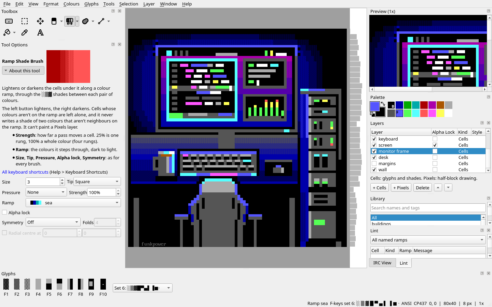

<p align="center"></p>

A native editor for ANSI and IRC block art, with layers, generator scripts and
a live IRC byte budget, and a headless `blockwright-cli` built from the same
core. C++20 and Qt 6, for Linux, macOS, Windows and FreeBSD.

<p align="center"></p>

## Install

Every release's files are on the
[latest release page](https://git.pumpin.online/funkpower/blockwright/releases/latest).
In the file names below, `<version>` is the release's version, such as
`0.1.1`, and each file but the `PKGBUILD` has a `.sha256` beside it. Every
package installs the editor, `blockwright`, and the command-line tool,
`blockwright-cli`. [Installing Blockwright](https://blockwright.pumpin.online/manual/01-install.html)
in the manual has each system's steps in full, with checking the downloads
and uninstalling.

### Arch Linux

The AUR package is coming but isn't up yet. Until it is, build the package
from the release's `PKGBUILD`, as a user who isn't root:

```sh
mkdir blockwright && cd blockwright
curl -LO https://git.pumpin.online/funkpower/blockwright/releases/download/v<version>/PKGBUILD
makepkg -si
```

makepkg downloads the source tarball from the release, checks it against the
checksum the `PKGBUILD` carries, builds it and runs the tests, and `-si`
installs the dependencies and the package. It puts `blockwright` and
`blockwright-cli` in `/usr/bin`.

### Debian and Ubuntu

A `.deb` is built for each of these releases and is for that release only:

| Release | File |
|---|---|
| Debian 13 (trixie) | `blockwright_<version>-1_debian13_amd64.deb` |
| Debian testing | `blockwright_<version>-1_debian-testing_amd64.deb` |
| Ubuntu 26.04 | `blockwright_<version>-1_ubuntu26.04_amd64.deb` |
| Ubuntu 26.10 | `blockwright_<version>-1_ubuntu26.10_amd64.deb` |

```sh
sudo apt install ./blockwright_<version>-1_<release>_amd64.deb
```

It puts `blockwright` and `blockwright-cli` in `/usr/bin`. Debian 12 and
Ubuntu 24.04 ship a Qt older than 6.7, the minimum; use the AppImage there.

### Fedora

Built for Fedora 45:

```sh
sudo dnf install ./blockwright-<version>-1.fc45.x86_64.rpm
```

It puts `blockwright` and `blockwright-cli` in `/usr/bin`.

### AppImage

For x86-64 Linux with glibc 2.36 or later (Debian 12, Ubuntu 24.04 and
newer). It carries its own Qt.

```sh
sha256sum -c blockwright-<version>-x86_64.AppImage.sha256
chmod +x blockwright-<version>-x86_64.AppImage
./blockwright-<version>-x86_64.AppImage
```

With `--cli` first it runs `blockwright-cli`, and so does a link to it under
a name that starts with `blockwright-cli`:

```sh
./blockwright-<version>-x86_64.AppImage --cli lint piece.ans
ln -s "$PWD/blockwright-<version>-x86_64.AppImage" ~/.local/bin/blockwright-cli
```

Where AppImageLauncher is installed the link starts the editor; use `--cli`
there. Running the AppImage needs FUSE: a `fusermount3` or `fusermount`
command on the `PATH`, from the `fuse3` package or the older FUSE 2 package.
Without one, set `APPIMAGE_EXTRACT_AND_RUN=1` or run it with
`--appimage-extract-and-run`.

### macOS

`Blockwright-<version>.dmg` is a universal app (Apple silicon and Intel) for
macOS 12 or later. Open it and drag Blockwright to Applications.

The app is signed ad hoc, not with a Developer ID, and is not notarized, so
Gatekeeper blocks the first run of a downloaded copy: of the app, and of
`blockwright-cli` inside it. Before using either, remove the quarantine flag
from the whole bundle, which clears both:

```sh
xattr -dr com.apple.quarantine /Applications/Blockwright.app
```

The app alone can also be allowed from System Settings > Privacy & Security
after its first launch is blocked; that leaves `blockwright-cli`
quarantined, and over ssh a quarantined `blockwright-cli` waits on a prompt
nothing can answer. The command-line tool is
`/Applications/Blockwright.app/Contents/MacOS/blockwright-cli`.

With Homebrew:

```sh
brew tap funkpower/tap https://git.pumpin.online/funkpower/homebrew-tap.git
brew install --cask funkpower/tap/blockwright
```

Homebrew 7 refuses the short name, `blockwright`, from a tap it doesn't
trust, so the cask is installed by its full name. It installs the app and
links `blockwright-cli` onto the PATH. Its caveat gives the same `xattr`
command, which both need before their first run.

### FreeBSD

`blockwright-<version>-freebsd-port.tar.gz` is the port, for FreeBSD 14. It
builds against the packaged Qt 6 and needs the ports framework in
`/usr/ports` (for example
`git clone --depth 1 https://git.FreeBSD.org/ports.git /usr/ports`). Install
the build dependencies from packages, then fetch the port, unpack it and
build it as root:

```sh
pkg install cmake ninja qt6-base qt6-svg libzip zstd
fetch https://git.pumpin.online/funkpower/blockwright/releases/download/v<version>/blockwright-<version>-freebsd-port.tar.gz
tar xzf blockwright-<version>-freebsd-port.tar.gz
cd blockwright
make install clean
```

`make install` downloads the source tarball from the release and checks it
against the port's `distinfo`. It puts `blockwright` and `blockwright-cli` in
`/usr/local/bin`. The port is not in the ports tree and there is no binary
package. `packaging/freebsd/` is the port's template, whose `distinfo` holds
zeros; [packaging/README.md § FreeBSD](packaging/README.md#freebsd) describes
how a release's port is written from it.

### Windows

`blockwright-<version>-x86_64.msi` is for 64-bit Windows 10 or later. It
isn't signed, so SmartScreen stops it with "Windows protected your PC":
click More info, then Run anyway. It installs for every user, so User
Account Control asks for an administrator's approval. It installs into
`C:\Program Files\Blockwright`, with `blockwright.exe` and
`blockwright-cli.exe` in its `bin` folder, which isn't put on the `PATH`, and
adds Blockwright to the Start menu. Uninstall it from Settings > Apps.
[packaging/windows/README.md](packaging/windows/README.md) describes how the
MSI is built.

### From source

See [Building](#building).

## What it does

**Layers.** A document is a stack of composited layers, each with its own
visibility, lock, alpha lock and place on the canvas. There are five kinds:

- **Cells**: a glyph with foreground and background colours in each cell.
- **Pixels**: two half-block pixels per cell, top and bottom, flattened to
  `▀▄█` and colours on export.
- **Text**: live text in a bundled face, a TheDraw font or 8×8 big lettering,
  editable with the Text tool until it is baked to cells.
- **Generator**: the cached output of a program kept in the project, with a
  parameter form in the Layers dock; changing a parameter runs it again.
- **Reference**: a picture to trace (File > Open Reference Image), placed,
  scaled and faded under or over the art, never exported. A project keeps a
  PNG or JPEG as it is and any other picture as a PNG.

A layer can carry a style (Layer > Layer Style: plate, glow, shadow, outline,
fill, shade and bevel). Layer > Bake Layer turns a live text layer, with or
without a style, a generator layer (its last output), or a Cells or Pixels
layer with a style, into a cells layer of what it shows; a Cells or Pixels
layer with no style can't be baked, and reference layers can't be baked at
all. The project format
also keeps a layer's blend mode (normal, chars-only or colours-only); the app
composites it but has no control to set it.

**Tools.** Keyboard typing with the F-key glyph sets, Select, Move/Transform,
the Half-Block, Shade, Ramp Shade, Form, Soft, Despeckle, Smudge, Glyph,
Colorize, Outline and Rim Light brushes, Line, Rectangle, Ellipse, Frame, Fill,
Ramp Gradient, Eyedropper, Texture Stamp, Clone Stamp, Glyph Spray and Text.
The shading brushes step cells along a colour ramp through `░▒▓`, and mirror
and radial symmetry repeat any stroke. Each tool's options are in the Tool
Options dock with its help; Help > Manual has every tool and layer kind.

**Generator layers.** A generator is any program that reads its parameters on
stdin and writes an `.ans` on stdout. Its files live in the project under
`scripts/<id>/` with a `generator.json` that names the command, the key colour
that reads as transparent and the parameters the form shows. Nothing runs
until asked: the app asks before a project's generators first run in a
session, and opening, saving or exporting only reads the cached cells.
File > Open Scene opens a Python scene as one generator layer per scene layer.

**IRC target and byte budget.** Format > Target sets a document to ANSI (the
16 colours an `.ans` holds) or IRC (mIRC's 99 colours, and bold, italic and
underline). An IRC line has a byte limit, so a row meter beside the canvas
encodes each row as export would and shows its bytes against the budget, red
over it. The budget is a preset (`efnet-weechat`, 407 bytes), a custom count
from 1 to 512, or worked out from a nick mask and channel (View > IRC >
Budget). View > IRC can fit long lines by merging the least visible colours,
pad lines so a client keeps the frame, and swap shades; the IRC View dock
shows the piece as a client would after its lines are cut.

**Micron target.** Format > Target > Micron (NomadNet) is for drawing pages
NomadNet shows. It has IRC's 99 colours, and a click on the pen's foreground
or background swatch (or Colours > Pick Foreground Colour...) offers any of
the 4096 colours a three-digit Micron code writes. A page has no byte limit,
so the row meter is put away and lint drops the rules about what IRC trims.
The canvas shows the cells as NomadNet draws them, and File > Export Micron
writes their colours as they are.

The Lint dock lists shading-ladder, pixel-noise and craft-rule findings and
follows each edit; activating one moves the cell cursor to its cell.

**Library.** A dock of stamps, text styles and frame styles, bundled and your
own. Selection > Save to Library and Save as Frame Style add to it.

## Formats

| Format | Read | Write |
|---|---|---|
| `.ans` with SAUCE, CP437 or UTF-8 | yes | yes |
| XBIN (`.xb`) | yes | yes |
| BIN (`.bin`) | yes | yes |
| IRC text (`.txt`, mIRC codes) | — | File > Export IRC Text, `export --irc` |
| Micron page (`.mu`, NomadNet) | — | File > Export Micron, `export --micron` |
| PNG | yes, as a reference image | `blockwright-cli render` |
| JPEG, BMP, GIF, ICO, PBM/PGM/PPM, XBM, XPM; WebP and TIFF with Qt's image formats plugin | yes, as a reference image | — |
| TheDraw fonts (`.tdf`) | yes, for text layers | — |
| Blockwright project | yes | yes |

A project is a `.bwp` zip, or the same layout unpacked as a directory for
version control and scripts: a `manifest.json`, one file per layer, generator
scripts, reference pictures, the fonts its text uses and numbered snapshots
(`snapshots/rN.ans`). `core/include/blockwright/project.h` and PLAN.md §6
describe it. Fonts for text layers are read from a fonts folder set in
Edit > Preferences.

## Samples

Nine sample projects install with the app and open from the start screen or
Help > Samples:

- `01-layers-showcase`, Harbour at night: every layer kind, both blend modes,
  locks, a generator, a text layer and its baked copy, and a reference sketch.
- `02-ddos-king`, DDOS KING: a crowned king in shades on a throne of server
  racks under packet lightning, a finished piece in fourteen layers over a
  locked backdrop, with variants and a snapshot a stage.
- `03-still-life`: a cylinder, a box and a ball shaded inside their own shapes
  under alpha locks, with cast shadows and a rim light on layers of their own.
- `04-generator-ridges`, Ridges at dusk: mountain ridges and stars from two
  shell-script generator layers under pixel pines and a cabin on layers of their own.
- `05-character`, Traveller: a figure in half-block pixels split into outline,
  body, face, highlights and shadow layers, with a merged copy to move it whole.
- `06-blockwright-logo`, Blockwright logo: the program's logo as the layers a
  block-letter logo is made of: the mark's blocks, pixel lettering, a drop under
  it and shade cells over it.
- `07-battlestation`, Battlestation: a night desk lit by its monitor, with the
  light the screen throws on a colours-only layer, so it goes out without a
  glyph moving, and the screen's panes under an alpha lock.
- `08-brain-on-irc`, This Is Your Brain on IRC: one egg in a pan, the yolk
  a dome and the pan a cylinder from one pass of the Form brush over flat
  copies kept hidden underneath, and the # and the highlight on layers of
  their own, out of the brush's way.
- `09-wtc-0903`, wtc-0903: Lower Manhattan at 9:03 on 11 September 2001, a
  hundred columns wide, with the morning sun on a layer apart from the towers
  it lights, colours-only reflections and the towers under alpha locks.

## Command line

`blockwright-cli` reads `.ans`, XBIN, BIN and projects (as their flattened
composite) without a display:

| Command | Does |
|---|---|
| `info <file>` | size, SAUCE fields, and a project's budget, layers and snapshots |
| `convert <in> <out>` | write `.ans`, XBIN or BIN, by `<out>`'s name |
| `render <in> <out.png>` | draw with the IBM VGA font; `--irc` draws the IRC view instead |
| `export --irc <in> <out.txt>` | write IRC text and report each line's bytes; over budget writes nothing unless `--allow-over-budget` |
| `export --micron <in> <out.mu>` | write a NomadNet Micron page in the piece's own colours; `--centre`, `--cache S` |
| `shade` | one pass of the ramp shade, form, despeckle or rim-light brush over a box or mask |
| `lint <in>` | shading-ladder, pixel-noise and craft checks, as text or `--json` |
| `library list [dir]`, `library check <dir>` | list or check stamps and text styles |
| `pack <in> <out.bwp>`, `unpack <in> <dir>` | write an `.ans` or project as a project zip or directory |
| `snapshot <project>` | save the composite as the project's next `snapshots/rN.ans` |
| `add-generator <project> <dir>` | add a generator layer from a directory with a `generator.json` |
| `run-generators <project>` | run the project's visible generator layers (or each `--layer`, hidden or not) again and save their output |
| `import-scene <scene.py> <out>` | make a project from a Python scene, a generator layer per scene layer |
| `replay <steps.json> -o <dir>` | apply a steps file through the editor's tools and write the canvas after each step |

`blockwright-cli --help` gives every option and `replay --help` the steps
format. Exit status: 0 ok, 1 bad input, a failure or a refused lossy write, 2 usage,
3 an IRC line over the budget, 4 lint findings.

`blockwright --list-actions` prints every menu and dock action of the app as
JSON (id, menu, text, default shortcuts, tips, tool and help ids) without
opening a window.

## Building

Needs CMake 3.24 or later, Ninja, Qt 6.7 or later (Core, Gui, Widgets,
Concurrent, Svg), libzip and zstd. Catch2 3 is downloaded for the tests when
it isn't installed (`-DBW_FETCH_CATCH2=OFF` to use only an installed one).

```sh
cmake -S . -B build -G Ninja -DCMAKE_BUILD_TYPE=RelWithDebInfo
cmake --build build
QT_QPA_PLATFORM=offscreen ctest --test-dir build
```

The tests need no display. `PLAN.md` is the design: the layer model, the
project and file formats, the IRC encoder and budgets, generators, the brushes
and the decisions behind them.

`packaging/README.md` covers building each package, and
`packaging/RELEASING.md` the order a release is made in.

## Licence

GPL-3.0-or-later; see `LICENSE` and `NOTICE`.
