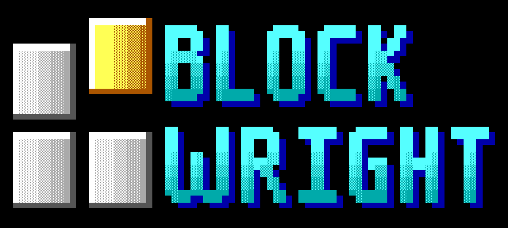
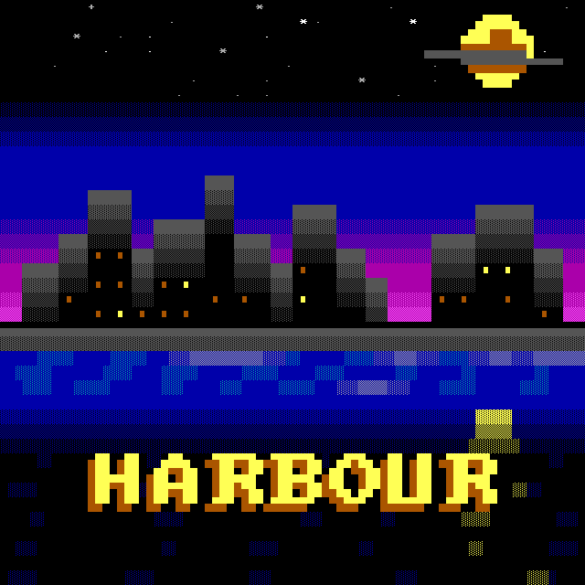

<p align="center"></p>

A native editor for ANSI and IRC block art, with layers, generator scripts and
a live IRC byte budget, and a headless `blockwright-cli` built from the same
core. C++20 and Qt 6, for Linux, macOS, Windows and FreeBSD.

<p align="center"></p>

## What it does

**Layers.** A document is a stack of composited layers, each with its own
visibility, lock, alpha lock and place on the canvas. There are five kinds:

- **Cells**: a glyph with foreground and background colours in each cell.
- **Pixels**: two half-block pixels per cell, top and bottom, flattened to
  `▀▄█` and colours on export.
- **Text**: live text in a bundled face, a TheDraw font or 8×8 big lettering,
  editable with the Text tool until it is baked to cells.
- **Generator**: the cached output of a program kept in the project, with a
  parameter form in the Layers dock; changing a parameter runs it again.
- **Reference**: a picture to trace (File > Open Reference Image), placed,
  scaled and faded under or over the art, never exported. A project keeps a
  PNG or JPEG as it is and any other picture as a PNG.

A layer can carry a style (Layer > Layer Style: plate, glow, shadow, outline,
fill, shade and bevel). Layer > Bake Layer turns a live text layer, with or
without a style, a generator layer (its last output), or a Cells or Pixels
layer with a style, into a cells layer of what it shows; a Cells or Pixels
layer with no style can't be baked, and reference layers can't be baked at
all. The project format
also keeps a layer's blend mode (normal, chars-only or colours-only); the app
composites it but has no control to set it.

**Tools.** Keyboard typing with the F-key glyph sets, Select, Move/Transform,
the Half-Block, Shade, Ramp Shade, Form, Soft, Despeckle, Smudge, Glyph,
Colorize, Outline and Rim Light brushes, Line, Rectangle, Ellipse, Frame, Fill,
Ramp Gradient, Eyedropper, Texture Stamp, Clone Stamp, Glyph Spray and Text.
The shading brushes step cells along a colour ramp through `░▒▓`, and mirror
and radial symmetry repeat any stroke. Each tool's options are in the Tool
Options dock with its help; Help > Manual has every tool and layer kind.

**Generator layers.** A generator is any program that reads its parameters on
stdin and writes an `.ans` on stdout. Its files live in the project under
`scripts/<id>/` with a `generator.json` that names the command, the key colour
that reads as transparent and the parameters the form shows. Nothing runs
until asked: the app asks before a project's generators first run in a
session, and opening, saving or exporting only reads the cached cells.
File > Open Scene opens a Python scene as one generator layer per scene layer.

**IRC target and byte budget.** Format > Target sets a document to ANSI (the
16 colours an `.ans` holds) or IRC (mIRC's 99 colours, and bold, italic and
underline). An IRC line has a byte limit, so a row meter beside the canvas
encodes each row as export would and shows its bytes against the budget, red
over it. The budget is a preset (`efnet-weechat`, 407 bytes), a custom count
from 1 to 512, or worked out from a nick mask and channel (View > IRC >
Budget). View > IRC can fit long lines by merging the least visible colours,
pad lines so a client keeps the frame, and swap shades; the IRC View dock
shows the piece as a client would after its lines are cut. The Lint dock
lists shading-ladder, pixel-noise and craft-rule findings and follows each
edit; activating one moves the cell cursor to its cell.

**Library.** A dock of stamps, text styles and frame styles, bundled and your
own. Selection > Save to Library and Save as Frame Style add to it.

## Formats

| Format | Read | Write |
|---|---|---|
| `.ans` with SAUCE, CP437 or UTF-8 | yes | yes |
| XBIN (`.xb`) | yes | yes |
| BIN (`.bin`) | yes | yes |
| IRC text (`.txt`, mIRC codes) | — | File > Export IRC Text, `export --irc` |
| Micron page (`.mu`, NomadNet) | — | File > Export Micron, `export --micron` |
| PNG | yes, as a reference image | `blockwright-cli render` |
| JPEG, BMP, GIF, ICO, PBM/PGM/PPM, XBM, XPM; WebP and TIFF with Qt's image formats plugin | yes, as a reference image | — |
| TheDraw fonts (`.tdf`) | yes, for text layers | — |
| Blockwright project | yes | yes |

A project is a `.bwp` zip, or the same layout unpacked as a directory for
version control and scripts: a `manifest.json`, one file per layer, generator
scripts, reference pictures, the fonts its text uses and numbered snapshots
(`snapshots/rN.ans`). `core/include/blockwright/project.h` and PLAN.md §6
describe it. Fonts for text layers are read from a fonts folder set in
Edit > Preferences.

## Samples

Six sample projects install with the app and open from the start screen or
Help > Samples:

- `01-layers-showcase`, Harbour at night: every layer kind, both blend modes,
  locks, a generator, a text layer and its baked copy, and a reference sketch.
- `02-ddos-king`, DDOS KING: a crowned king in shades on a throne of server
  racks under packet lightning, a finished piece in fourteen layers over a
  locked backdrop, with variants and a snapshot a stage.
- `03-still-life`: a cylinder, a box and a ball shaded inside their own shapes
  under alpha locks, with cast shadows and a rim light on layers of their own.
- `04-generator-ridges`, Ridges at dusk: mountain ridges and stars from two
  shell-script generator layers under pixel pines and a cabin on layers of their own.
- `05-character`, Traveller: a figure in half-block pixels split into outline,
  body, face, highlights and shadow layers, with a merged copy to move it whole.
- `06-blockwright-logo`, Blockwright logo: the program's logo as the layers a
  block-letter logo is made of: the mark's blocks, pixel lettering, a drop under
  it and shade cells over it.

## Command line

`blockwright-cli` reads `.ans`, XBIN, BIN and projects (as their flattened
composite) without a display:

| Command | Does |
|---|---|
| `info <file>` | size, SAUCE fields, and a project's budget, layers and snapshots |
| `convert <in> <out>` | write `.ans`, XBIN or BIN, by `<out>`'s name |
| `render <in> <out.png>` | draw with the IBM VGA font; `--irc` draws the IRC view instead |
| `export --irc <in> <out.txt>` | write IRC text and report each line's bytes; over budget writes nothing unless `--allow-over-budget` |
| `export --micron <in> <out.mu>` | write a NomadNet Micron page in the piece's own colours; `--centre`, `--cache S` |
| `shade` | one pass of the ramp shade, form, despeckle or rim-light brush over a box or mask |
| `lint <in>` | shading-ladder, pixel-noise and craft checks, as text or `--json` |
| `library list [dir]`, `library check <dir>` | list or check stamps and text styles |
| `pack <in> <out.bwp>`, `unpack <in> <dir>` | write an `.ans` or project as a project zip or directory |
| `snapshot <project>` | save the composite as the project's next `snapshots/rN.ans` |
| `add-generator <project> <dir>` | add a generator layer from a directory with a `generator.json` |
| `run-generators <project>` | run the project's visible generator layers (or each `--layer`, hidden or not) again and save their output |
| `import-scene <scene.py> <out>` | make a project from a Python scene, a generator layer per scene layer |
| `replay <steps.json> -o <dir>` | apply a steps file through the editor's tools and write the canvas after each step |

`blockwright-cli --help` gives every option and `replay --help` the steps
format. Exit status: 0 ok, 1 bad input, a failure or a refused lossy write, 2 usage,
3 an IRC line over the budget, 4 lint findings.

`blockwright --list-actions` prints every menu and dock action of the app as
JSON (id, menu, text, default shortcuts, tips, tool and help ids) without
opening a window.

## Platforms and packages

Linux, macOS, Windows and FreeBSD. `packaging/README.md` covers the packages:
a source tarball, Arch (AUR), Debian and Ubuntu, Fedora and an AppImage on
Linux; a FreeBSD port; a macOS app, disk image and Homebrew cask; and a
Windows MSI.

## Building

Needs CMake 3.24 or later, Ninja, Qt 6.7 or later (Core, Gui, Widgets,
Concurrent, Svg), libzip and zstd. Catch2 3 is downloaded for the tests when
it isn't installed (`-DBW_FETCH_CATCH2=OFF` to use only an installed one).

```sh
cmake -S . -B build -G Ninja -DCMAKE_BUILD_TYPE=RelWithDebInfo
cmake --build build
QT_QPA_PLATFORM=offscreen ctest --test-dir build
```

The tests need no display. `PLAN.md` is the design: the layer model, the
project and file formats, the IRC encoder and budgets, generators, the brushes
and the decisions behind them.

## Licence

GPL-3.0-or-later; see `LICENSE` and `NOTICE`.
