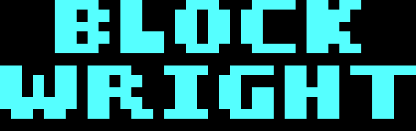

<p align="center"></p>

A native editor for ANSI and IRC block art, with layers, generator scripts and
a live IRC byte budget, and a headless `blockwright-cli` built from the same
core. C++20 and Qt 6, for Linux, macOS and Windows.

## Building

Needs CMake 3.24 or later, Ninja, Qt 6.7 or later (Core, Gui, Widgets,
Concurrent, Svg), libzip and zstd. Catch2 3 is downloaded for the tests when
it isn't installed.

```sh
cmake -S . -B build -G Ninja -DCMAKE_BUILD_TYPE=RelWithDebInfo
cmake --build build
QT_QPA_PLATFORM=offscreen ctest --test-dir build
```

`PLAN.md` is the design, and `packaging/README.md` covers the packages.

## Licence

GPL-3.0-or-later; see `LICENSE` and `NOTICE`.
